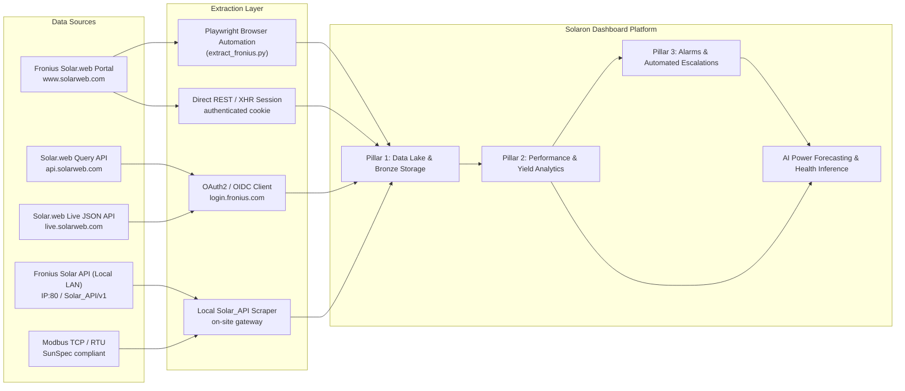
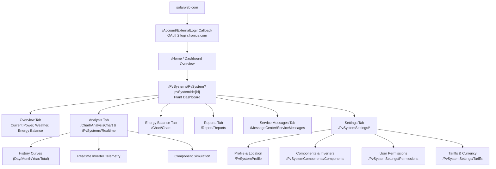

# Fronius Solar.web — Complete Data Sitemap & Extractable Analytics

> Comprehensive map of every extractable data point, analytical surface, and variable from `solarweb.com` / `login.fronius.com`, organized for the **Solaron Dashboard MVP** — power generation modeling, variable impact analysis, device-level health tracking, and alert-driven plant management.

---

## Architecture Overview



---

## Web Portal Navigation Structure



---

## Access Tiers & Protocol Summary

| Tier | Cost | Auth Method | Rate Limit / Polling | Data Scope | Best For |
|---|---|---|---|---|---|
| **Solar.web Portal (Web UI)** | Included with hardware | OIDC (User + Password) | Session-bound (5 min live) | Full system dashboard, charts, service messages, report generator | Scraping, historical batch export, configuration validation |
| **Solar.web Query API** | Free Basic / Paid Pro | API Key (`accessKeyId` + `accessKeyValue`) | Basic: 100 req/day; Pro: Higher | Cloud-to-cloud historical & aggregated telemetry (JSON) | Solaron hourly/daily pipeline synchronization |
| **Solar.web Live JSON API** | Bundled with Datamanager | Session cookie / JWT | ~10-15 sec refresh | Real-time PV power, grid feed-in, battery state, load consumption | Real-time plant status indicator on dashboard |
| **Fronius Solar_API v1 (Local LAN)** | Free (Local Datamanager) | None / Digest Auth | 1-5 sec polling | Deep inverter register telemetry: MPPT voltage/current, AC frequency, state codes | On-site high-resolution telemetry logging |
| **Modbus TCP (SunSpec)** | Free (Hardware) | Port 502 (TCP) | Real-time polling | Complete SunSpec model 101/103/160 string-level registers | Industrial SCADA & EMS direct telemetry |

---

## 1. 🏭 Plant-Level Data (PV System)

### 1.1 Plant Overview & Metadata
*Inspected on verified system: **Green Ridge Tower CHSL** (ID: `813eef59-b211-4de0-9ac1-dfa8fd473ebf`)*

| Field Name | Portal Location | Data Type | Solaron Analytics Use |
|---|---|---|---|
| `pvSystemId` | URL parameter (`?pvSystemId=...`) | UUID String | **Primary unique identifier** across all Fronius API queries |
| `name` | System Header / Profile | String | Display name & customer matching |
| `peakPower` | Header / Profile | Float (kWp) | **Installed DC capacity (12.50 kWp baseline for PR & Specific Yield)** |
| `address` | Profile / Location | String | Geographic tagging (`Chincholi Bunder Road, Malad West`) |
| `city` / `state` / `zip` | Profile / Location | String | Regional solar irradiance (GHI) benchmarking (`Mumbai, Maharashtra 400064`) |
| `country` | Profile / Location | String | National regulatory and grid compliance |
| `installationDate` | Profile Settings | ISO Date | **Degradation tracking** & lifecycle calculation |
| `timeZone` | Profile Settings | String | Timestamp normalization (`Asia/Kolkata, UTC+05:30`) |
| `currency` | Tariffs / Profile | String | Financial revenue normalization (`INR / ₹`) |
| `weatherCondition` | Overview Widget | String / Temp (°C) | Real-time ambient condition impact (e.g., `36°C, Sunny`) |
| `pvSystemRole` | UserPermissions | String | Permission clearance (`Supervisor`, `Owner`, `Guest`) |

### 1.2 Plant Energy & Earnings Totals
| Metric | Portal Tab | Unit / Granularity | Analytics Impact |
|---|---|---|---|
| `Current Power (Pac)` | Overview Bubble | Real-time kW / W | Live grid generation status & offline anomaly detection |
| `Energy Today (E-Today)` | Overview / Energy Balance | kWh / Daily | **Daily generation KPI** vs expected clear-sky model |
| `Energy This Month` | History / AnalysisChart | kWh / Monthly | **Monthly billing & WhatsApp generation statements** |
| `Energy This Year` | History / AnalysisChart | MWh / Annual | Annual yield compliance and warranty verification |
| `Total Lifetime Energy` | Overview Production Card | MWh (e.g., 529.03 MWh) | Cumulative asset generation accounting |
| `Total Financial Earnings` | Overview Production Card | INR (e.g., ₹1,893,862.42) | Client savings ROI metrics calculated at configured tariff |
| `CO2 Avoided Total` | Overview / Reports | Tons / kg | ESG sustainability and carbon credit reporting |

### 1.3 Time-Series Chart Channels (`/Chart/AnalysisChart`)
| Channel Name | Available Intervals | Units | Description & Diagnostic Value |
|---|---|---|---|
| `Solar Energy (Yield)` | Day / Month / Year / Total | Wh / kWh / MWh | Total energy generated by the PV array |
| `Power (Pac)` | 5-min intervals (Day view) | W / kW | **Intraday generation curve shape** (bell curve vs clipping vs shading) |
| `Self-Consumption` | Day / Month / Year | Wh / kWh | Energy consumed directly on-site without entering grid |
| `Grid Feed-In` | Day / Month / Year | Wh / kWh | Net-metered surplus power exported to local discom |
| `Grid Consumption` | Day / Month / Year | Wh / kWh | Power imported from discom during night or peak load |
| `Component Simulation` | Custom date range | kW / kWh | Theoretical vs actual yield simulation under selected hardware |

---

## 2. ⚡ Inverter & Hardware-Level Data

### 2.1 Inverter Component Inventory (`/PvSystemComponents/Components`)
*Detected on Green Ridge Tower CHSL:*

| Component Parameter | Portal Field | Value / Format | Engineering Analytics Use |
|---|---|---|---|
| `Inverter Name` | Component List | String | Inverter reference name |
| `Device Type / Model` | Component Header | `Fronius Symo 12.5-3-M` / `Fronius Eco 25.0-3-S` | **Inverter efficiency classification & MPPT specs** |
| `Device Serial Number` | Component Details | 8-digit numeric (e.g. `29841857`) | **Hardware tracking & OEM warranty validation** |
| `Installed Power (Wp)` | Component Details | Numeric (e.g. `12500 Wp`) | Rated DC input allocation per inverter |
| `Firmware Version` | Software Update | e.g. `fro34150.upd` | Firmware bug tracking & firmware mismatch alerts |
| `Datamanager Version` | System Details | Fronius Datamanager 2.0 / Pilot | Communication gateway status & buffer capacity |
| `Communication Protocol` | Datamanager Settings | Solar API v1 / Modbus TCP | Protocol capability selection |

### 2.2 Deep Telemetry Registers (Local Solar_API & Solar.web Pro)
| Telemetry Channel | Unit | Sampling Frequency | Diagnostic & Fault Analysis Value |
|---|---|---|---|
| `U_DC (String Voltage)` | V DC | 5-min / 1-sec local | Detects blown string fuses, PID degradation, or panel open-circuits |
| `I_DC (String Current)` | A DC | 5-min / 1-sec local | Detects localized string shading, heavy soiling, or bypass diode shorts |
| `U_AC_L1 / L2 / L3` | V AC | 5-min / 1-sec local | **Grid overvoltage trip detection** (frequent cause of inverter shutdown in India) |
| `I_AC_L1 / L2 / L3` | A AC | 5-min / 1-sec local | Phase load balancing & inverter current limiting |
| `Frequency (FAC)` | Hz | 5-min / 1-sec local | Grid frequency fluctuation monitoring (49.5 Hz - 50.5 Hz standard) |
| `Inverter Temperature` | °C | 5-min / 1-sec local | Overheating thermal throttling detection (fan failure or dust clogged heatsink) |
| `Isolation Resistance (R_ISO)` | kOhm | Daily startup | DC earth fault & moisture ingress warning before morning startup |

---

## 3. 🚨 Service Messages & Fault Intelligence (`/MessageCenter/ServiceMessages`)

Fronius features a standardized state code architecture categorized into three severity levels:

### 3.1 Severity Classifications
- 🔴 **Error (Severe Fault)**: Inverter stops feeding grid immediately. Requires urgent technician dispatch.
- 🟡 **Warning (Service Advisory)**: Inverter operating with derated capacity or transient condition.
- 🔵 **Information (Audit Event)**: Configuration updates, firmware downloads, network restarts.

### 3.2 Common Fronius State Codes Encountered in Fleet Management
| State Code | Category | Root Cause | Solaron Automated Action |
|---|---|---|---|
| **State 102** | Grid / AC | AC voltage exceeds upper trip limit | Log grid overvoltage; alert discom if persistent |
| **State 105** | Grid / AC | AC grid frequency out of permissible range | Monitor discom stabilization; hold technician dispatch |
| **State 301** | Hardware | Overcurrent on AC output | Automated reset test; dispatch technician if repeats 3x |
| **State 307** | Grid / AC | DC feed-in into AC grid detected | High-priority safety alert; inspect inverter internal isolation |
| **State 443** | Energy Yield | Intermediate circuit voltage too low | Check DC string array continuity & morning irradiance |
| **State 447** | Hardware | Inverter cooling fan fault | **Thermal warning**: dispatch cleaning team to check heatsink/fans |
| **State 475** | Grid / Sensor | Solar Net communication interruption | Verify Datamanager cable connections & WiFi strength |
| **State 509** | Hardware | No generation within 24 hours (Zero generation) | **Critical Offline Alert**: trigger WhatsApp alert to owner & Solaron team |

---

## 4. 📊 Reports & Automated Extraction (`/Report/Reports`)

### 4.1 Native Solar.web Report Types
| Report Name | Execution Interval | Formats | Extractable Data Points |
|---|---|---|---|
| **Energy Report** | Daily / Weekly / Monthly | MS Excel (.xls), CSV, PDF | Detailed energy generation per hour/day, self-consumption %, feed-in |
| **Component Comparison** | Monthly / Custom | MS Excel (.xls), CSV | Inverter-vs-inverter yield comparison across multi-inverter sites |
| **Service Message Log** | Custom range | PDF, CSV | Timestamped chronological log of all state codes, duration, and resolution |

### 4.2 Automated Web Scraping & Playwright Session Strategy
```python
# Direct Navigation Endpoints for Automated Scraping:
BASE_URL = "https://www.solarweb.com"
LOGIN_URL = "https://login.fronius.com/oauth2/authorize"

ENDPOINTS = {
    "dashboard": f"{BASE_URL}/PvSystems/PvSystem?pvSystemId={PV_SYSTEM_ID}",
    "day_chart": f"{BASE_URL}/Chart/AnalysisChart?pvSystemId={PV_SYSTEM_ID}&view=Day&date={DATE}",
    "month_chart": f"{BASE_URL}/Chart/AnalysisChart?pvSystemId={PV_SYSTEM_ID}&view=Month&date={MONTH}",
    "year_chart": f"{BASE_URL}/Chart/AnalysisChart?pvSystemId={PV_SYSTEM_ID}&view=Year&date={YEAR}",
    "reports": f"{BASE_URL}/Report/Reports?pvSystemId={PV_SYSTEM_ID}",
    "messages": f"{BASE_URL}/MessageCenter/ServiceMessages?pvSystemId={PV_SYSTEM_ID}",
    "components": f"{BASE_URL}/PvSystemComponents/Components?pvSystemId={PV_SYSTEM_ID}",
}
```

---

## 5. 🔌 Solar.web REST API Reference (`api.solarweb.com`)

For high-throughput, headless extraction without browser overhead:

### 5.1 Endpoints Specification
| Method | Endpoint | Description |
|---|---|---|
| `GET` | `/pvsystems` | List all accessible PV systems under authenticated credentials |
| `GET` | `/pvsystems/{pvSystemId}` | Comprehensive plant metadata, capacity, address, and device count |
| `GET` | `/pvsystems/{pvSystemId}/devices` | Inverter models, serial numbers, datamanagers, and sensor bridges |
| `GET` | `/pvsystems/{pvSystemId}/data/live` | Real-time power (`Pac`), energy today, current load, and battery SOC |
| `GET` | `/pvsystems/{pvSystemId}/data/aggregated` | Historical energy aggregated by `hour`, `day`, `month`, or `year` |
| `GET` | `/pvsystems/{pvSystemId}/service-messages` | REST query of active and historical fault codes with timestamps |

### 5.2 Header Authentication Schema
```http
GET /pvsystems/813eef59-b211-4de0-9ac1-dfa8fd473ebf/data/live HTTP/1.1
Host: api.solarweb.com
AccessKeyId: <FRONIUS_ACCESS_KEY_ID>
AccessKeyValue: <FRONIUS_ACCESS_KEY_VALUE>
Accept: application/json
```

---

## 6. Solaron Dashboard Integration Priority

| Priority | Feature / Surface | Source Extraction Method | Dashboard Destination |
|:---:|---|---|---|
| **P0** | **Live Generation & Daily Yield** | Solar.web Live JSON / Playwright | `daily_generation` table & Fleet KPI dashboard card |
| **P0** | **Offline & Fault Detection** | ServiceMessages (`State 509`, `State 102`) | `fleet_status_and_alerts` & Escalation State Machine |
| **P1** | **Monthly Energy Totals** | `/Chart/AnalysisChart` (view=Month) | `monthly_generation` table & Client WhatsApp Statements |
| **P1** | **Inverter Hardware Registration** | `/PvSystemComponents/Components` | `inverter_snapshots` & Plant Specs registry |
| **P2** | **Intraday Power Curves (5-min)** | `/Chart/AnalysisChart` (view=Day) | `fleet_high_res_power_curves.csv` & Anomaly engine |
| **P2** | **Automated Scheduled XLS Export** | `/Report/Reports` Background trigger | Bronze data lake archiving (`data/bronze/fronius/`) |
