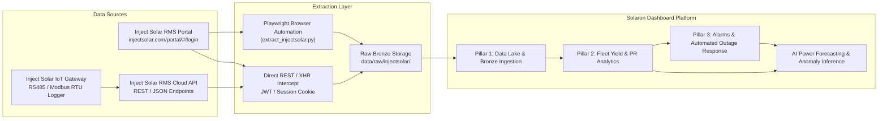
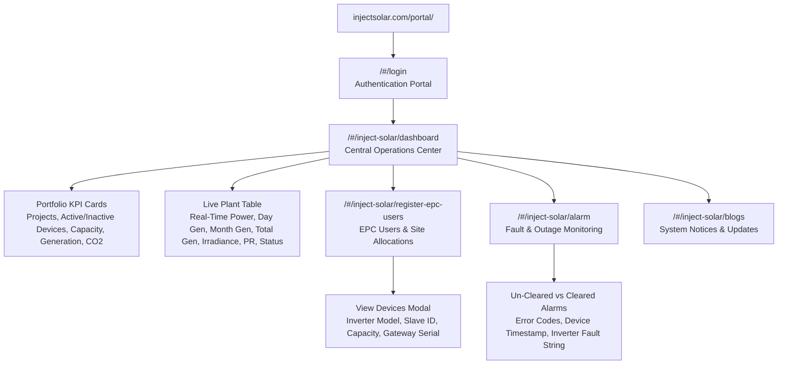

# Inject Solar RMS Portal — Complete Data Sitemap & Extractable Analytics

> Comprehensive map of every extractable data point, analytical surface, and variable from `injectsolar.com/portal/`, organized for the **Solaron Dashboard MVP** — fleet power generation modeling, device-level health tracking, inverter status monitoring, and alert-driven plant management.

---

## Architecture Overview



---

## Web Portal Navigation Structure



---

## Access Tiers & Protocol Summary

| Tier | Cost | Auth Method | Rate Limit / Polling | Data Scope | Best For |
|---|---|---|---|---|---|
| **Inject Solar RMS Portal (Web UI)** | Bundled with RMS logger | Username + Password (`solaron`) | Web-session bound | Fleet dashboard, plant tables, inverter modal, alarm logs | Automated scraping, initial fleet discovery, daily audit |
| **Inject Solar REST / XHR API** | Included with cloud account | Bearer Token / Session Cookie | High-frequency JSON | Live telemetry, raw device registers, historical time-series | Headless Solaron ETL pipeline integration |
| **Local RS485 / Modbus Gateway** | Hardware on-site | Serial RS485 (9600-115200 bps) | Real-time (1-5 sec) | Direct inverter MPPT voltage/current, AC grid registers | Local edge logging & offline failover |

---

## 1. 🏭 Fleet-Level Data (`/#/inject-solar/dashboard`)

*Verified Solaron account: **SOLARON HOMES PVT LTD** (`solaron`)*

### 1.1 Executive Portfolio Summary Cards
| Metric Card | Value (Verified Audit) | Unit | Solaron Analytics Impact |
|---|---|---|---|
| `Total No of Projects` | 7 | Count | Portfolio scale & active contract count |
| `Total Devices Installed` | 7 | Count | Hardware asset tracking |
| `Active Devices` | 2 | Count | **Operational fleet availability metric** (28.6% online) |
| `In-Active Devices` | 5 | Count | **Critical fleet outage indicator** (71.4% offline) |
| `Total Solar Capacity` | 177.74 / 167.74 | kW | Fleet rated generation capacity baseline |
| `Total Energy Generated` | 384,183.07 | kWh | Cumulative lifetime fleet energy accounting |
| `Total CO2 Saved` | 315,030.12 | kg | ESG environmental sustainability metric |

### 1.2 Live Plant Fleet Table
The dashboard table displays every monitored installation with instant real-time telemetry:

| Column Field | Data Type | Sample Data (Audit) | Engineering / CRM Value |
|---|---|---|---|
| `Project Name` | String / Slug | `rasrajfactory`, `bhagatsingh` | Primary plant identifier slug |
| `Display Name` | String | `Rasraj Factory`, `Bhagat Singh` | Customer-facing plant name |
| `Installed Capacity` | Float (kW) | 60.00 kW, 51.93 kW, 10.40 kW | Denominator for Specific Yield ($kWh / kWp$) |
| `Current Power` | Float (kW) | 0.0 kW, 25.3 kW, 6.8 kW | **Real-time generation state** |
| `Today's Generation` | Float (kWh) | 0.0 kWh, 89.8 kWh, 28.0 kWh | **Daily yield tracking for billing & WhatsApp** |
| `Month Generation` | Float (kWh) | Cumulative kWh | Monthly performance tiering & customer billing |
| `Total Generation` | Float (kWh) | Cumulative kWh | Asset lifecycle monitoring |
| `Irradiation` | Float ($W/m^2$) | Sensor or satellite GHI | **Expected generation baseline for PR calculation** |
| `Performance Ratio (PR)` | Percentage (%) | Calculated PR % | **Inverter & plant conversion efficiency benchmark** |
| `Status` | Badge | `Online` (Green) / `Offline` (Red) | **Automated offline outage trigger** |

#### Verified Plant Fleet Inventory (Audit Snapshot):
| # | Plant Slug | Display Name | Capacity | Status | Current Power | Today's Generation |
|:-:|---|---|:-:|:---:|:---:|:---:|
| 1 | `rasrajfactory` | Rasraj Factory | 60.00 kW | 🔴 Offline | 0.0 kW | 0.0 kWh |
| 2 | `bhagatsingh` | Bhagat Singh | 51.93 kW | 🟢 Online | 25.3 kW | 89.8 kWh |
| 3 | `vinaythacker` | Vinay Thacker | 10.40 kW | 🔴 Offline | 0.0 kW | 0.0 kWh |
| 4 | `velloz` | Velloz | 15.08 kW | 🔴 Offline | 0.0 kW | 0.0 kWh |
| 5 | `gogas` | Go Gas | 10.40 kW | 🔴 Offline | 0.0 kW | 0.0 kWh |
| 6 | `shah` | Shah | 10.08 kW | 🔴 Offline | 0.0 kW | 0.0 kWh |
| 7 | `babade` | Babade | 19.85 kW | 🟢 Online | 6.8 kW | 28.0 kWh |

---

## 2. ⚡ Device & Inverter Specifications (`/#/inject-solar/register-epc-users`)

Under the EPC user directory, the portal provides a detailed hardware mapping modal for every site:

| Device Parameter | Field Label | Data Type | Diagnostic Analytics Purpose |
|---|---|---|---|
| `Device Name / Model` | Inverter Model | String (e.g. `Sungrow 50kW`, `Growatt 15kW`) | **Inverter efficiency curve & manufacturer mapping** |
| `Device ID` | Device Identifier | String / Hex | Unique IoT logger / datalogger serial number |
| `Slave ID` | Modbus Address | Integer (e.g. `1`, `2`) | Multi-inverter daisy chain bus addressing |
| `Rated Capacity` | Capacity | Float (kW) | Individual inverter rated power |
| `Connection State` | Device Status | Active / Inactive | Gateway-to-inverter RS485 communication link health |
| `Contract / Reg Date` | Registration Date | Date (DD-MM-YYYY) | Maintenance SLA & warranty commencement |

---

## 3. 🚨 Alarms & Incident Management (`/#/inject-solar/alarm`)

Inject Solar provides an active fault tracking interface divided into **Un-Cleared** and **Cleared** event logs:

### 3.1 Alarm Table Schema
| Field | Type | Description / Example | Solaron Escalation Action |
|---|---|---|---|
| `Alarm ID` | String | Unique fault transaction ID | Audit tracking key |
| `Error Code` | String | e.g. `E2088`, `E1004` | Lookup in inverter vendor fault catalog |
| `Device Name` | String | e.g. `DEV-1`, `Inverter-1` | Pinpoint specific failing inverter unit |
| `Plant Name` | String | e.g. `Rasraj Factory` | Customer plant mapping |
| `Fault Category` | String | `Device Offline`, `No DC Power`, `Grid Fail` | **Severity classification** (Critical vs Advisory) |
| `Timestamp` | DateTime | Timestamp when condition triggered | Outage duration timer calculation |
| `Status` | String | `Un-cleared` / `Cleared` | Open incident ticket tracking |

### 3.2 Typical Fault Signatures & Solaron Automated Rules
| Fault Pattern | Condition | Root Cause Analysis | System Action |
|---|---|---|---|
| **`Device Offline`** | Zero data packets for > 60 min | WiFi logger disconnected / power cut to gateway | Check AC power to logger; send WhatsApp check alert |
| **`No DC Power`** | Daytime hours ($GHI > 200 W/m^2$) + DC current = 0 | DC isolator open / blown DC fuse / string disconnection | Alert technician for physical DC switch verification |
| **`Grid Outage`** | Inverter status indicates grid fault | Local discom blackout or line trip | Suppress plant fault alarm; log grid downtime |
| **`Inverter Derating`** | Ambient temp high + power < 70% expected | Thermal throttling due to dust on heatsink | Recommend cleaning visit to plant owner |

---

## 4. 📊 Data Extraction & Playwright Session Strategy

### 4.1 Automated Web Extraction Endpoints
```python
# Direct Navigation Endpoints for Automated Scraping:
BASE_URL = "https://injectsolar.com/portal/#"
LOGIN_URL = f"{BASE_URL}/login"

ENDPOINTS = {
    "dashboard": f"{BASE_URL}/inject-solar/dashboard",
    "users_devices": f"{BASE_URL}/inject-solar/register-epc-users",
    "alarms": f"{BASE_URL}/inject-solar/alarm",
    "blogs": f"{BASE_URL}/inject-solar/blogs",
}
```

### 4.2 DOM Target Selectors for Automated Data Harvesting
| Target Data | CSS / DOM Selector | Extraction Method |
|---|---|---|
| Username Field | `input[type="text"]`, `input[placeholder*="username" i]` | Type credentials |
| Password Field | `input[type="password"]` | Type credentials |
| Login Button | `button[type="submit"]`, `.login-btn` | Click & wait for navigation |
| KPI Summary Cards | `.dashboard-card`, `.stat-widget` | Extract text & numeric values |
| Plant Table Rows | `table tbody tr`, `.plant-row` | Iterate rows, parse columns |
| Device Modal | `.modal-body table tbody tr` | Extract inverter serials & slave IDs |
| Alarm Rows | `.alarm-table tbody tr` | Extract active un-cleared fault codes |

---

## 5. Solaron Dashboard Integration Priority

| Priority | Feature / Surface | Source Extraction Method | Dashboard Destination |
|:---:|---|---|---|
| **P0** | **Live Generation & Outage State** | `/#/inject-solar/dashboard` Table | `daily_generation` table & Fleet Status card |
| **P0** | **Offline Devices Trigger** | `/#/inject-solar/dashboard` (5 Offline) | `fleet_status_and_alerts` & Escalation engine |
| **P1** | **Active Fault Codes** | `/#/inject-solar/alarm` (Un-cleared) | Technician visit scheduling & Service queue |
| **P1** | **Monthly Energy Totals** | Monthly column in dashboard table | Client WhatsApp Generation Statements |
| **P2** | **Inverter Hardware Registry** | View Devices modal | `inverter_snapshots` & Plant Specs registry |
| **P2** | **Solar Irradiance & PR Tracking** | Irradiation column & PR % | Physics-based expected generation model |
